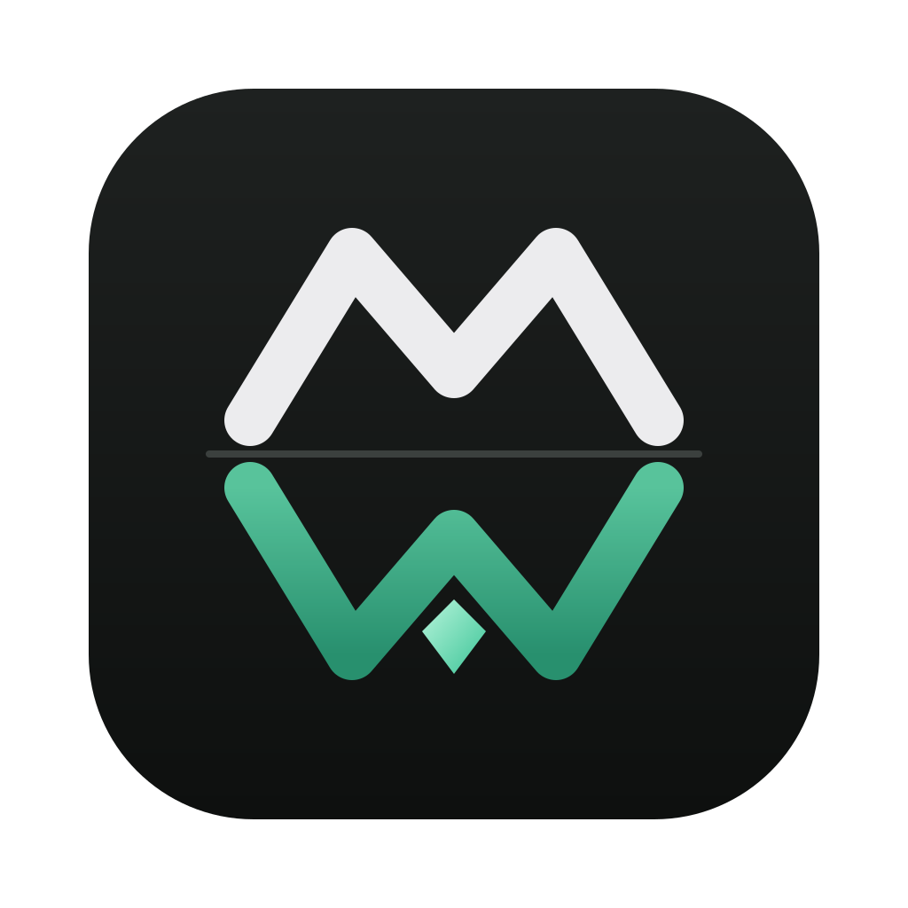
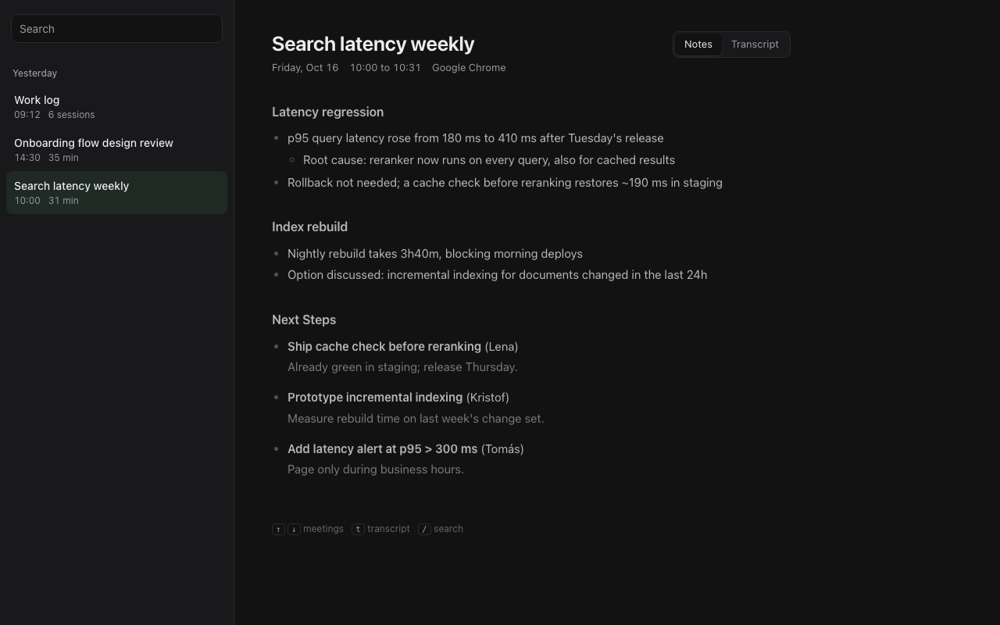

<p align="center">
  
</p>

<h1 align="center">merkwerk</h1>

<p align="center">
  <b>Your meetings and your workday, written down. Entirely on your Mac.</b><br>
  Local transcription, meeting notes, a daily work log and an MCP server. In pure Rust.
</p>

<p align="center">
  
</p>

---

*merkwerk* is German for roughly "memory works": *merken* means to notice and remember, *Werk*
is work. It listens to your calls, reads what you work on, and turns both into notes you can
search, read, or hand to an AI assistant. It runs fully offline: no accounts, no subscription,
no usage limits, no cloud.

## Disclaimer: read this first

> **Never record people without their consent.** Recording conversations is regulated, and the
> rules depend on where you and the other participants are. Many places require the consent of
> **everyone** in a conversation (for example Germany, most of the EU under GDPR, California and
> several other US states). Workplace recording and screen monitoring can be subject to further
> rules, works council agreements or company policy.
>
> - Tell participants that you record and transcribe, and get their agreement **before** you start.
> - Do not record calls where you cannot get consent. Use **Ignore** or turn auto-recording off.
> - Screen activity can contain other people's messages and personal data. Treat the files
>   accordingly and delete what you do not need.
>
> **Use at your own risk.** merkwerk is provided "as is", without warranty of any kind (see
> [LICENSE](LICENSE)). You alone are responsible for how you use it and for complying with the
> laws and agreements that apply to you. The authors accept no liability for recordings made
> with it or for their consequences.

## Your data stays on your machine

- Audio, transcripts, notes and screen activity are **plain files in `~/merkwerk`**. Nothing is
  uploaded anywhere.
- Speech recognition runs locally (Parakeet or whisper). Notes are written by a local LLM through
  Ollama by default.
- merkwerk makes exactly two kinds of network requests: the **one-time model download** from
  Hugging Face (`merkwerk model`), and calls to **the LLM endpoint you configure**, which is
  `localhost` unless you change it. No telemetry, no analytics, no update checks.
- If you point `MERKWERK_LLM_URL` at a hosted API, transcripts and activity text are sent there.
  That is your choice; the default never leaves your Mac.

## What it does

| | |
|---|---|
| **Recording on your terms** | Manual by default: when a call starts, merkwerk asks. Turn on auto-recording if you want every call captured, and opt out of any single call with one click. |
| **Always visible** | While recording, a floating pill shows `● Recording 03:12` on every desktop, the Dock icon carries a `REC` badge, and the menu bar shows a timer. |
| **Call detection** | Notices when Zoom, Meet, Teams, Slack, FaceTime or any other app starts using the microphone, without bots joining your call. |
| **Both sides of the call** | Records your microphone as `me` and the system audio as `them`. |
| **Local transcription** | NVIDIA Parakeet TDT 0.6B v3 (25 languages, punctuation, automatic language detection) or whisper large-v3-turbo. Silero VAD filters silence so the models don't invent text. Live, in 30 second chunks. |
| **Meeting notes** | Topic sections and next steps with owners, in English, from any OpenAI-compatible LLM. |
| **Ask** | Chat with a meeting while it runs or afterwards: "What did I miss?", "My action items", answers cite timestamps. Works for a day's work log too. |
| **Screen activity** | Reads the text of the window you are working in through macOS Accessibility: app, window title, URL, content. No screenshots, no OCR. |
| **Daily work log** | Every night, the day becomes a log grouped by project, with tickets, PRs, documents, meetings and open threads. |
| **MCP server** | Ask Claude, Cursor or any MCP client about your meetings and your work. |
| **Raw files** | Everything is JSON, Markdown and WAV in a folder you own. Grep it, back it up, delete it. |

## Install

Requirements: macOS 14.6 or newer, Apple Silicon recommended, the
[Rust toolchain](https://rustup.rs), and [Ollama](https://ollama.com) for notes (optional; any
OpenAI-compatible endpoint works).

```sh
git clone https://github.com/ArzelaAscoIi/merkwerk.git
cd merkwerk
cargo install --path .
merkwerk model          # one-time download: Parakeet v3 (~670 MB) + Silero VAD (1 MB)
ollama pull gemma4      # the default notes model
merkwerk                # opens the notes window and starts watching
```

On first use macOS asks for these permissions, for the terminal or app that runs merkwerk:

| Permission | Why |
|---|---|
| Microphone | your side of the call |
| System Audio Recording | the other side of the call (System Settings > Privacy & Security > Screen & System Audio Recording) |
| Accessibility | reading window text for the work log |

## Using it

**Recording modes**

- **Manual (default).** When another app starts using the microphone, the pill shows
  `Call detected  Zoom  [Record] [Ignore]` and the Dock icon bounces once. Nothing is recorded
  until you click **Record**. You can also start a recording anytime from the menu
  (**Start recording**, ⌘R), for example for a conversation in person.
- **Auto-record.** Enable **Auto-record calls** in the Dock or menu bar menu. Every detected call
  is recorded; click **Stop** to opt out of that call. The choice is saved in
  `~/merkwerk/settings.json`.

A recording of a call ends 15 seconds after the app releases the microphone. Notes are written in
the background, so a back-to-back call is still caught.

**Models**

Pick both models from the Dock or menu bar menu, no restart needed:

- **Speech model**: Parakeet v3 (fastest, 25 languages) or Whisper large-v3-turbo (99 languages).
  A model you have not used yet is downloaded in the background when you pick it; the next
  recording uses it.
- **Notes model**: any model installed in Ollama, e.g. `gemma4:26b` for more careful notes.

Choices are saved in `~/merkwerk/settings.json`; the environment variables below override them.

**Reading**

The notes window opens at launch and with a click on the Dock icon. Meetings and work logs are
grouped by day; the raw transcript (or the raw window sessions of a work log) sits behind the
toggle. Keys: `↑` `↓` move, `t` toggles the raw view, `/` searches.

**Asking**

Under every meeting (and every work log) is a chat: type a question or pick one of the
suggestions. During a call it reads the transcript up to that moment, so "What did I miss?" works
when you join late or drift off. Follow-up questions keep the context. Press `a` to jump to it.

**Footprint**

merkwerk is meant to run all day. Measured on an M4 Pro: about 0.2% of one CPU core and 55 MB
memory while idle with the notes window open; the speech model (about 0.5 to 0.75 GB) is loaded
only while a recording is transcribed and released afterwards. Screen capture skips its work
while you are not typing or clicking, and closing the notes window ends its WebKit process.

**Command line**

```
merkwerk [watch]          notes window, call detection, screen activity (default)
merkwerk record [title]   record now from the terminal, Enter to stop
merkwerk list             list meetings
merkwerk show <id>        print notes and transcript
merkwerk notes            open only the notes window
merkwerk activity [date]  screen activity of a day
merkwerk day [date]       write the work log for a day
merkwerk ask <id> <q>     ask about a meeting, or <date>_log for a day
merkwerk transcribe <id>  re-run speech recognition on saved audio
merkwerk summarize <id>   rewrite transcript.md and notes
merkwerk mcp              MCP server on stdio
merkwerk model            download the speech models
```

## MCP

```sh
claude mcp add merkwerk -- merkwerk mcp
```

| Tool | Returns |
|---|---|
| `list_meetings` | meetings, newest first |
| `get_meetings` | metadata and notes for meeting ids |
| `get_meeting_transcript` | the full transcript, paged, also while a meeting is running |
| `search_meetings` | text search across transcripts and notes |
| `get_activity` | a day's window sessions with text excerpts |
| `get_work_log` | the day's work log (written on first request) |
| `search_activity` | everything you had on screen, by keyword |

## How it works

```
 microphone ─┐                       ┌─ Silero VAD ─ Parakeet / whisper ─ transcript.jsonl
             ├─ 16 kHz mono ─ wav ───┤                                            │
 system out ─┘   (CoreAudio tap)     └─────────────────────────── LLM ─ summary.md ┘

 frontmost window ─ Accessibility text ─ activity/<day>.jsonl ─ LLM ─ activity/<day>.md
```

- **Call detection** reads CoreAudio's per-process input state (macOS 14.2+), so merkwerk's own
  recording never counts as a call. Other recorders (Granola, screenpipe) are ignored by default.
- **Capture** uses [cpal](https://github.com/RustAudio/cpal) for the microphone and CoreAudio
  loopback for system audio.
- **Transcription** runs Silero VAD on each 30 second chunk and sends only speech to
  [parakeet-rs](https://github.com/altunenes/parakeet-rs) (ONNX Runtime) or
  [whisper-rs](https://github.com/tazz4843/whisper-rs).
- **Screen activity** walks the focused window's accessibility tree every 5 seconds and pauses
  when you are idle or the screen is locked. Per app and window it stores the full text once a
  day, then only the lines that are new (about half the size of full snapshots on real data).
- **UI** is native AppKit through [objc2](https://github.com/madsmtm/objc2); the notes view is a
  single self-contained HTML page in a WKWebView, rendered from Rust.

## Files

```
~/merkwerk/
  settings.json                 recording mode, screen activity switch, model choices
  vocab.txt                     optional: names and terms, one per line, for correct spelling in notes
  2026-10-16_100000/            one folder per meeting
    meta.json                   title, app, start, end
    me.wav  them.wav            audio, 16 kHz mono
    transcript.jsonl            segments {source, start, end, text}, grows live
    transcript.md               [hh:mm:ss] me|them: text
    summary.md                  notes
  activity/
    2026-10-16.jsonl            screen activity {ts, app, window, url, text | add}
    2026-10-16.md               work log
  models/                       speech models
```

## Privacy controls for screen activity

- Switch it off and on anytime with **Record screen activity** in the Dock or menu bar menu (saved
  in `settings.json`). While off, merkwerk reads nothing from the screen.
- Never captured: password fields, password managers (1Password, Bitwarden, LastPass, Dashlane,
  KeePass), Keychain, the lock screen, and private or incognito browser windows.
- Add your own exclusions with `MERKWERK_SCREEN_IGNORE` (app names, bundle ids or window title
  fragments, comma-separated). `MERKWERK_SCREEN=0` or `1` overrides the menu switch.
- Token-like strings (API keys, access tokens) are masked before anything is written.
- Delete a day by deleting its file. Nothing else keeps a copy.

## Configuration

All settings are environment variables; the defaults are fully local.

| Variable | Default |
|---|---|
| `MERKWERK_DIR` | `~/merkwerk` |
| `MERKWERK_ENGINE` | `parakeet` (or `whisper`; also selectable in the menu) |
| `MERKWERK_MODEL` | `$MERKWERK_DIR/models/ggml-large-v3-turbo-q5_0.bin` (whisper) |
| `MERKWERK_LANG` | whisper only: `en,de` (candidate languages per utterance) |
| `MERKWERK_LLM_URL` | `http://localhost:11434/v1/chat/completions` |
| `MERKWERK_LLM_MODEL` | `gemma4` (also selectable in the menu) |
| `MERKWERK_LLM_KEY` | unset (Bearer token for hosted APIs) |
| `MERKWERK_ME` | first name of your macOS account (how notes refer to you) |
| `MERKWERK_IGNORE` | `merkwerk,granola,screenpipe,openwhispr` (apps whose mic use is not a call) |
| `MERKWERK_SCREEN` | on (`0` turns screen activity off; also switchable in the menu) |
| `MERKWERK_SCREEN_IGNORE` | unset (extra apps or windows never captured) |

## Limitations

- macOS only.
- Without headphones the microphone also picks up the speakers, so the other side can appear in
  your channel.
- Speakers are separated by channel (`me` and `them`), not per person.
- Back-to-back calls in the same app can end up in one recording if the next call grabs the
  microphone right away.
- Apps that draw their content as pixels (some terminals, remote desktops, games) only show their
  window title in the activity log.

## Contributing

Issues and pull requests are welcome. Please keep the core principles: local by default, plain
files, no telemetry. Run `cargo fmt`, `cargo clippy` and `cargo test` before opening a PR.

## License

merkwerk is released under the [MIT License](LICENSE).

The speech models are not part of this repository. `merkwerk model` downloads them from Hugging
Face, and they keep their own licenses:

| Model | Author | License | Source |
|---|---|---|---|
| Parakeet TDT 0.6B v3 | NVIDIA | [CC-BY-4.0](https://creativecommons.org/licenses/by/4.0/) | [nvidia/parakeet-tdt-0.6b-v3](https://huggingface.co/nvidia/parakeet-tdt-0.6b-v3), used as the int8 ONNX conversion by [istupakov/parakeet-tdt-0.6b-v3-onnx](https://huggingface.co/istupakov/parakeet-tdt-0.6b-v3-onnx) (CC-BY-4.0) |
| Whisper large-v3-turbo (ggml) | OpenAI, converted by the whisper.cpp project | MIT | [ggerganov/whisper.cpp](https://huggingface.co/ggerganov/whisper.cpp) |
| Silero VAD v5 (ggml) | Silero Team, converted by ggml-org | MIT | [ggml-org/whisper-vad](https://huggingface.co/ggml-org/whisper-vad) |

The default notes model, Gemma 4 by Google, is installed through Ollama and licensed under
Apache-2.0. Product names mentioned in this README belong to their owners; merkwerk is not
affiliated with any of them.
